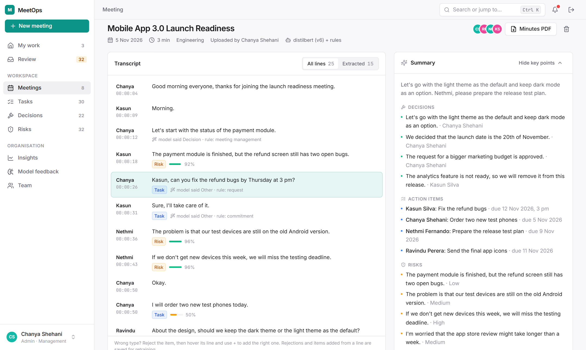

# MeetOps — Intelligent Enterprise Meeting Management System

**CO3554 Data Management Project · University of Sri Jayewardenepura**
N.K.C. Shehani · Index 22/ENG/107 · Registration EN108977

MeetOps converts meeting inputs (audio, video, or text transcripts) into structured
enterprise records — **Tasks, Decisions, and Risks** — each linked to an owner, a
deadline, and the exact transcript segment that produced it. The goal is to give
small and medium enterprises a task tracker, decision register, and risk log that
are generated automatically from the meetings they already hold.



More screens: [docs/features.md](docs/features.md) (every page with a screenshot) and
[docs/screenshots/](docs/screenshots/).

## Project status

| Phase (from proposal timeline)                    | Status         |
|---------------------------------------------------|----------------|
| Background research and requirements              | ✅ Done         |
| Frontend dashboard (React)                        | ✅ Done (v2 design, light/dark) |
| Dataset preparation (AMI corpus → utterances)     | ✅ Done         |
| Annotation guideline and labelled sample          | ✅ Done (v1)    |
| Classification experiments (Task/Decision/Risk)   | ✅ v1–v3 + rule layer, in-domain evaluation |
| Information extraction (owner, deadline)          | ✅ Rule-based v1, evaluated |
| Database schema and FastAPI backend               | ✅ Done (SQLite / PostgreSQL) |
| Accounts, departments, role-based access, audit log | ✅ Done        |
| Human review of extracted items, label feedback   | ✅ Done         |
| Summaries, recurring risks, evidence links        | ✅ v1 (extractive / TF-IDF similarity) |
| Risk clustering into themes                       | ✅ MiniLM sentence vectors + agglomerative clustering |
| PDF export (meeting minutes, registers)           | ✅ Done (reportlab) |
| Retraining on review feedback                     | ✅ Export, retrain, compare gate (v7 rejected, v6 kept) |
| Audio/video pipeline (Whisper + speaker separation) | ✅ v1 (local, CPU) |
| DistilBERT classifier (fine-tuned)                | ✅ v6, macro-F1 0.56 AMI / 0.65 business meetings, 0.78 with the rule layer |
| Evidence audio clips, email reminders, speech evaluation on AMI | ⏳ Remaining weeks |

## Repository layout

```
meetops/
├── frontend/   React + TypeScript + Tailwind dashboard (Vite)
├── backend/    FastAPI application and PostgreSQL schema
├── ml/         Data preparation, annotation, classification and extraction
├── docs/       Architecture, setup guides, screenshots, reports
└── scripts/    Utility scripts (e.g. AMI corpus parsing)
```

## Quick start

Requires Node.js 18+ and Python 3.11.

**1. Backend + ML** (Python virtual environment at the repository root)

```bash
python -m venv .venv
.venv\Scripts\activate                      # Windows; on macOS/Linux: source .venv/bin/activate
python -m pip install torch --index-url https://download.pytorch.org/whl/cpu
python -m pip install -e "ml[transformer]" -r backend/requirements.txt
# train the classifier used by the app (fine-tuned DistilBERT, about 25 minutes on a laptop CPU)
python -m meetops_ml.transformer train --version v6 --train ml/data/labeled/train_v3.csv --test ml/data/labeled/test_v1v2.csv ml/data/labeled/indomain_v1.csv --no-context
cd backend
python -m app.seed --empty                  # empty database (or --demo for a demo organisation)
python -m uvicorn app.main:app --reload --port 8000
```

**2. Frontend** (second terminal)

```bash
cd frontend
npm install
npm run dev                                 # http://localhost:5173
```

On an empty database the dashboard asks you to create the first
administrator, who then adds departments and colleagues on the Team page.
Each person signs in with their own account. `python -m app.seed --demo`
instead creates a demo organisation and runs the sample transcripts through
the real pipeline. The dashboard only shows data from the backend; if the API
is not running it says so instead of showing sample data.

Upload `backend/samples/sprint8_planning.txt` on the New meeting page to watch
the pipeline classify a transcript and extract tasks, decisions and risks
(more sample meetings in `backend/samples/`).
Audio and video files are transcribed on the server; the first recording
downloads the Whisper model (`base.en`, about 140 MB) and the speaker model
(26 MB) once (see `backend/README.md`, section 6).

A faster setup without PyTorch: `python -m pip install -e ml -r backend/requirements.txt`
and `python -m meetops_ml.train --version v4 --train ml/data/labeled/train_v3.csv --features full`
trains the TF-IDF model instead; the backend uses it automatically when PyTorch
is not installed.
PostgreSQL instead of SQLite: `docker compose up -d` in `backend/` and set
`DATABASE_URL` (see `backend/README.md`).

Details per part: `frontend/README.md`, `backend/README.md`, `ml/README.md`,
`docs/annotation-guidelines.md`.

## System architecture

```
Audio / Video / Transcript
        │
        ▼
 Ingestion ──► audio track (PyAV) ──► Whisper ASR + voice clustering ──► Transcript with speakers
                                                              │
                                                              ▼
                                     Preprocessing: cleaning + utterance segmentation
                                                              │
                                                              ▼
         Classification: fine-tuned DistilBERT ──► rule layer ──► Task / Decision / Risk / Other
                                                              │
                                                              ▼
              Extraction + organising: owner, deadline, titles, merged replies, severity
                                                              │
                                                              ▼
              Review: every item is a suggestion that a person confirms or rejects
                                                              │
                                                              ▼
                                   PostgreSQL ──► FastAPI ──► React dashboard
```

## Technology stack

- **Frontend:** React 18, TypeScript, Vite, Tailwind CSS, React Router, Recharts
- **Backend:** FastAPI (Python), SQLAlchemy, PostgreSQL (SQLite for development), pytest
- **Machine learning / NLP:** scikit-learn (TF-IDF, Logistic Regression, Linear SVM, Naive Bayes, Random Forest), fine-tuned DistilBERT (PyTorch, Hugging Face transformers), rule-based and spaCy extraction with dateparser
- **Speech and media:** faster-whisper (Whisper, CTranslate2), PyAV (FFmpeg libraries), sherpa-onnx speaker embeddings
- **Dataset:** AMI Meeting Corpus, annotated with Label Studio
- **Tooling:** GitHub Actions (frontend, backend and ML checks), Docker Compose

## Documentation

| Document | Content |
|----------|---------|
| [docs/features.md](docs/features.md) | Every screen with screenshots and what it does |
| [docs/architecture.md](docs/architecture.md) | Components, data flow, pipeline stages, design decisions |
| [docs/database-schema.md](docs/database-schema.md) | ER diagram and table reference |
| [docs/annotation-guidelines.md](docs/annotation-guidelines.md) | Labelling rules for Task / Decision / Risk / Other |
| [docs/demo-script.md](docs/demo-script.md) | Presentation walkthrough and video plan |
| [ml/README.md](ml/README.md) | Data pipeline, labelled datasets, training protocol, results v1–v3, rule layer, in-domain evaluation, extraction results |
| [backend/README.md](backend/README.md) | Accounts and roles, API reference, schema, pipeline, PostgreSQL setup |
| [frontend/README.md](frontend/README.md) | Screens, project structure, API client |
