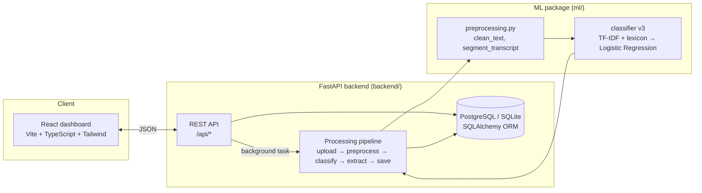

# MeetOps — System Architecture

MeetOps turns meeting recordings and transcripts into structured, traceable
records: **Tasks** (with owner and deadline), **Decisions** and **Risks**,
each linked to the exact transcript line it came from. This document describes
the components, how data flows between them, and the technology choices.

## 1. Overview



| Layer | Technology | Responsibility |
|-------|------------|----------------|
| Frontend | React 18, TypeScript, Vite, Tailwind CSS, Recharts, React Router | Sign-in, My work, review inbox, meetings with transcripts, task list and board, decision register, risk log, insights, team management, command palette |
| API | FastAPI, Pydantic | REST endpoints with camelCase JSON; sign-in and role checks; validation; background processing; audit log |
| Persistence | SQLAlchemy 2 over PostgreSQL 16 (Docker) or SQLite (development) | Eleven tables, see [database-schema.md](database-schema.md) |
| ML | scikit-learn, pandas, joblib | Utterance classifier (Task / Decision / Risk / Other), preprocessing shared with the backend |
| Extraction | Rule-based (regex + dateparser) | Owner, deadline, risk severity, recurring-risk similarity, extractive summary |
| Data | AMI Meeting Corpus (CC BY 4.0), Label Studio | Labelled training/test sets, see [annotation-guidelines.md](annotation-guidelines.md) |
| Planned (semester 2) | FFmpeg, Whisper / faster-whisper, DistilBERT | Audio/video ingestion, ASR, semantic classifier |

## 2. Request flow for an upload

```mermaid
sequenceDiagram
    actor U as User
    participant FE as Dashboard
    participant API as FastAPI
    participant BG as Pipeline (background task)
    participant ML as meetops_ml
    participant DB as Database

    U->>FE: choose transcript, title, date
    FE->>API: POST /api/meetings/upload (multipart)
    API->>DB: insert meeting (status Queued, stage upload)
    API-->>FE: 201 Meeting
    API->>BG: process_meeting(id)
    loop every 1.5 s
        FE->>API: GET /api/meetings/{id}
        API-->>FE: status + pipelineStage
    end
    BG->>ML: segment_transcript(text)
    BG->>ML: Classifier.predict(utterances)
    ML-->>BG: label + confidence per utterance
    BG->>BG: extract owner, deadline, severity; recurring risks; summary
    BG->>DB: segments, tasks, decisions, risks, audit entry; status Processed
    FE->>API: GET /api/meetings/{id}/segments, /api/tasks?meetingId=…
```

The pipeline stages are reported through `pipelineStage` so the Upload page
can draw progress. Failures are recorded on the meeting (`status: Failed`,
`errorMessage`) instead of crashing the server.

## 3. Processing pipeline in detail

| Stage | Module | What it does |
|-------|--------|--------------|
| upload | `backend/app/routers/meetings.py` | Validates the file type and size, stores the file, creates the meeting row |
| transcribe | `services/pipeline.py` | Skipped for text transcripts. Audio/video will go through FFmpeg → Whisper (next phase); today they stop here with a clear message |
| preprocess | `ml/src/meetops_ml/preprocessing.py` | `segment_transcript` splits `Speaker: text` lines (optional `[hh:mm:ss]`) into one utterance per sentence. `clean_text` normalises text for the model: joins spelled letters (T_V_ → tv), expands contractions (I'll → i will), removes fillers (um, uh, you know), collapses stutters (we we → we) |
| classify | `ml/src/meetops_ml/features.py`, `models.py`, `rules.py` | Word TF-IDF (1–2-grams) + character TF-IDF (2–5-grams) + a risk-cue lexicon, Logistic Regression with balanced class weights; then the rule layer corrects explicit requests, commitments, agreements and concerns and removes agenda lines and open questions. The model's label, the final label, the confidence and the rule are all stored |
| extract | `backend/app/services/organise.py`, `extraction.py` | A request and its acceptance become one task; the title is rewritten as an action; owner = person addressed or who accepted, else the speaker of "I'll …"; deadline = time expression in the exchange, resolved from the meeting date; vague agreements quote what was agreed; duplicate tasks merged; risk severity from cue words |
| save | `services/summary.py`, `pipeline.py` | Review status (confirmed only when the model alone is ≥ 0.8 confident, otherwise suggested); recurring risks by TF-IDF cosine similarity with earlier meetings; extractive summary; notifications to owners and to the uploader for review; audit log entry |

The same `clean_text` runs at training time and inside the saved model, so
the classifier always sees text in the form it was trained on.

## 4. Model lifecycle

```mermaid
flowchart LR
    AMI[AMI corpus XML] -->|scripts/parse_ami.py| U[ami_utterances.csv]
    U -->|scripts/make_prelabels.py| P[ami_prelabels.csv<br/>weak labels]
    P -->|labelstudio_tasks.py| LS[Label Studio batches]
    LS -->|manual review| L[train_v2.csv / test_v1.csv]
    L -->|python -m meetops_ml.train| M[ml/models/vN/<br/>classifier.joblib + reports]
    M -->|Classifier.load| B[Backend pipeline]
```



Every training run follows the same protocol: 5-fold cross-validation on the
training set selects the model, the test set (two complete meetings, natural
class distribution) is scored once. Results and error analysis are in
[`ml/README.md`](../ml/README.md).

## 5. Design decisions

- **Evidence links.** Every task, decision and risk stores `segment_id`. The
  UI jumps to that line of the transcript, so nothing the system claims is
  unverifiable.
- **Real data only.** All pages read through `frontend/src/api`; there is no
  sample data in the frontend. If the backend is unreachable the dashboard
  says so. Demo content is produced by running sample transcripts through the
  real pipeline (`python -m app.seed --demo`).
- **Hybrid classification.** A statistical model plus a small, named rule layer
  taken from the annotation guideline. The model is still evaluated on its
  own; the rules are reported as a separate row, and every rule change is
  visible on the transcript line it affected.
- **People confirm, the system proposes.** Uncertain items are *suggestions*.
  Confirming, rejecting or relabelling takes one click, and each correction is
  stored in `label_feedback`, the training data for the next model. Accuracy
  therefore improves on the organisation's own meetings over time.
- **Accounts and roles.** Departments, one account per person, three roles
  (admin, manager, member). Passwords are scrypt-hashed, sessions are
  HMAC-signed tokens, and every endpoint checks the role.
- **Database portability.** SQLAlchemy lets development run on a SQLite file
  with zero setup while the deployment target stays PostgreSQL (Docker
  Compose provided). Tables are created on start-up.
- **Classical ML first.** A TF-IDF + Logistic Regression model trains in
  seconds, is interpretable (top features per class are written out on every
  run), and establishes an honest baseline before a transformer is tried.
- **Recall over precision for extracted items.** Balanced class weights make
  the classifier surface more candidate tasks and risks; a user can dismiss a
  wrong suggestion in one click but cannot recover one that was never shown.
- **Rule-based extraction v1.** Owners and deadlines follow a small set of
  explicit patterns that are transparent and testable; the labelled
  `owner_span` / `deadline_span` columns are its evaluation set and the path
  to a learned extractor later.
- **Audit log.** Every create, update, review and relabel writes an
  `audit_logs` row with the acting user; it also feeds the activity stream.

## 6. Repository layout

```
meetops/
├── frontend/   React dashboard (see frontend/README.md)
├── backend/    FastAPI service, schema, pipeline, tests (see backend/README.md)
├── ml/         data pipeline, labelled datasets, classifier package, experiments (see ml/README.md)
├── scripts/    AMI parsing, pre-labelling and Label Studio batch tools
├── docs/       this document, database schema, features, demo script, annotation guidelines, screenshots
└── .github/    CI workflows (frontend, backend, ml)
```
