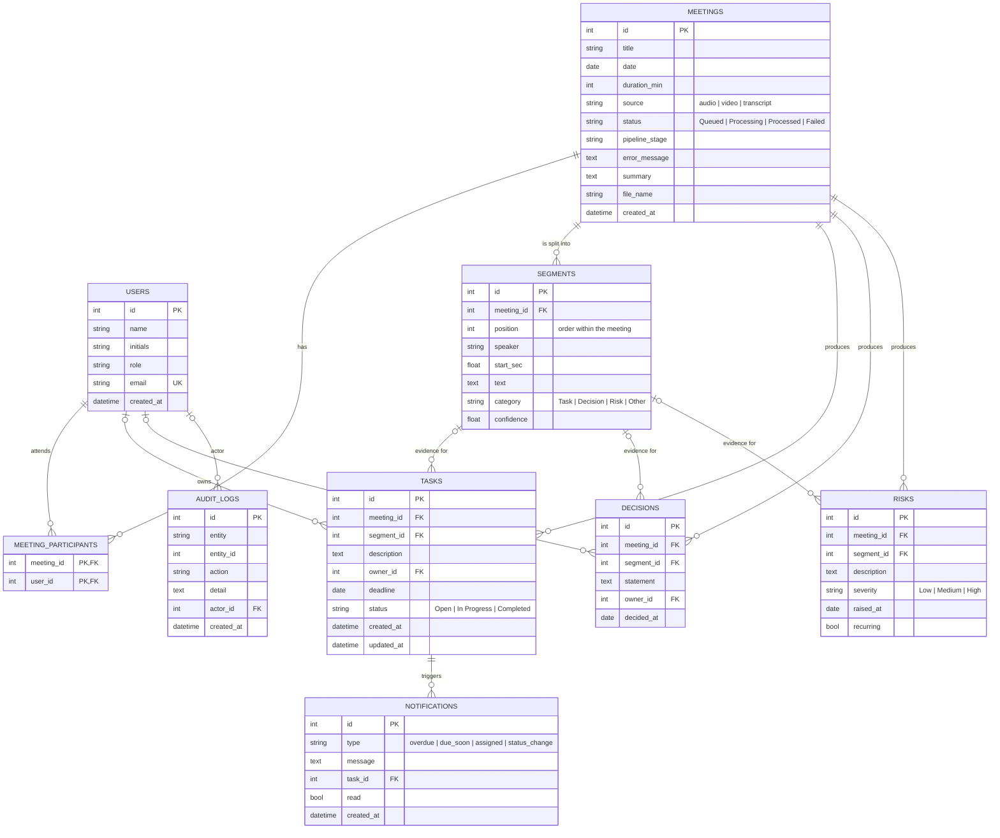

# MeetOps — Database Schema

Implemented in `backend/app/models.py` with SQLAlchemy 2. The same schema runs
on PostgreSQL 16 (target, via `backend/docker-compose.yml`) and on SQLite
(development default, file `backend/meetops.db`). Tables are created on
start-up; the seed script fills them with a sample project history.

## Entity-relationship diagram

## Design notes

- **Evidence link.** `tasks`, `decisions` and `risks` each carry `segment_id`
  (nullable, `ON DELETE SET NULL`). The dashboard uses it to open the meeting
  at that utterance. This is the traceability requirement of the project.
- **Cascade rules.** Deleting a meeting deletes its segments, tasks, decisions
  and risks (`ON DELETE CASCADE`). Deleting a user does not delete their tasks;
  the task becomes unassigned (`SET NULL`).
- **Indexes.** Foreign keys that are filtered by the API (`meeting_id`,
  `owner_id`) are indexed; `(meeting_id, position)` is unique so segments keep
  their order.
- **Status columns as strings.** `status`, `category`, `severity` and
  `source` are short strings validated by the API layer (Pydantic literals)
  rather than database enums, which keeps SQLite and PostgreSQL behaviour
  identical and makes adding a value a code change only.
- **Timestamps** are stored timezone-aware (UTC). Dates such as `deadline`
  and `decided_at` are plain dates because that is the granularity people use
  in meetings.
- **Audit log.** One row per create / update / delete / pipeline completion,
  with a free-text `detail` (for a task update: `status: Open -> Completed`).
  `actor_id` is nullable today and will be filled from the authenticated user
  once role-based access control is added.
- **Notifications** are derived from tasks (overdue, due soon) or written by
  the task endpoints (assigned, status change); one row per task and type.

## Row counts after seeding

| Table | Rows |
|-------|------|
| users | 6 |
| meetings | 4 |
| segments | 27 |
| tasks | 11 |
| decisions | 7 |
| risks | 7 |
| notifications | 1 (+ overdue / due-soon rows generated on first request) |
| audit_logs | 4 |

Uploading `backend/samples/sprint8_planning.txt` adds a fifth meeting with
14 segments and its extracted records.
