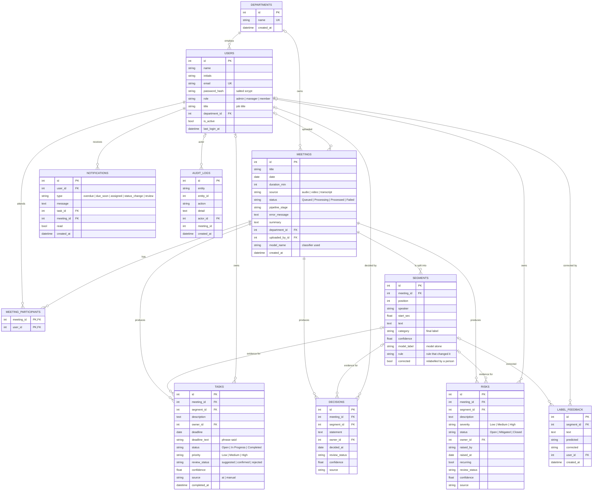

# MeetOps — Database Schema

Implemented in `backend/app/models.py` with SQLAlchemy 2. The same schema runs
on PostgreSQL 16 (target, via `backend/docker-compose.yml`) and on SQLite
(development default, file `backend/meetops.db`). Tables are created on
start-up; `python -m app.seed --empty` or `--demo` recreates them.

## Entity-relationship diagram

## Design notes

- **Evidence link.** `tasks`, `decisions` and `risks` each carry `segment_id`
  (`ON DELETE SET NULL`). The dashboard opens the meeting at that line.
- **Two labels per line.** `segments.model_label` is what the classifier said,
  `category` is the final label after the rule layer or a person's
  correction, `rule` names the rule that changed it. This keeps the model's
  own performance measurable inside the running system.
- **Review state.** Extracted items start as `suggested` unless the model
  alone was at least 0.8 confident (`confirmed`). A person confirms or
  rejects; rejected items are hidden from registers and counts but kept.
- **Learning from corrections.** Every rejection and relabel writes a
  `label_feedback` row: the sentence, the predicted label and the corrected
  one. Exported, these rows extend the training set for the next model.
- **Access control.** `users.role` and `department_id` drive the permission
  checks in `backend/app/security.py`; `meetings.department_id` and
  `uploaded_by_id` decide who may review a meeting's items.
- **Cascade rules.** Deleting a meeting deletes its segments and extracted
  items. Deleting or deactivating a person never deletes their tasks; owner
  links are set to null.
- **Indexes.** Foreign keys used by filters (`meeting_id`, `owner_id`,
  `department_id`, `user_id`) are indexed; `(meeting_id, position)` is unique
  so transcript lines keep their order.
- **Status columns as strings.** Validated by the API layer (Pydantic
  literals) rather than database enums, so SQLite and PostgreSQL behave the
  same and adding a value is a code change only.
- **Timestamps** are stored in UTC and sent to the browser marked as UTC.
  Dates people speak about (`deadline`, `decided_at`) are plain dates.

## After `python -m app.seed --demo`

| Table | Rows |
|-------|------|
| departments | 4 |
| users | 6 |
| meetings | 4 (processed by the real pipeline) |
| segments | 98 |
| tasks / decisions / risks | 16 / 11 / 13 |
| audit_logs | one per account and per meeting upload and processing |
